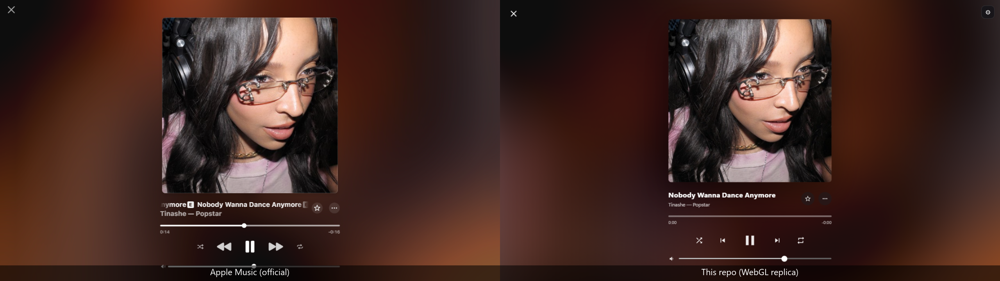
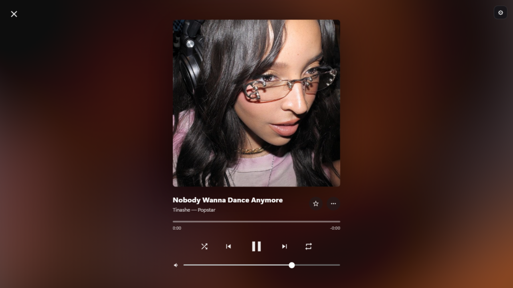

# Apple Music Web · 全屏播放器流体背景复刻

[](LICENSE)
[](demo/index.html)

对 **Apple Music 网页版**（`music.apple.com`）全屏播放器动态流体背景（社区常称 *Burst* / 流体渐变背景）进行的逆向工程分析与 **1:1 原生 WebGL 零依赖复刻**。

核心实现全部封装于单文件 [`demo/index.html`](demo/index.html)，无需构建工具、无需引入 PixiJS 等第三方运行时，开箱即用。

<p align="center">
  
</p>
<p align="center"><sub>效果对比：左侧为 Apple Music 网页版官方渲染帧，右侧为本仓库 WebGL 复刻实时渲染帧（同曲目、同封面、同为 1280×720 分辨率）。</sub></p>



---

## 快速开始

### 运行方式

```bash
# 方式一：直接双击在浏览器中打开
demo/index.html

# 方式二：通过本地静态服务器访问（推荐，确保在线封面跨域加载稳定）
python -m http.server 8000
# 访问 http://localhost:8000/demo/
```

### 交互与快捷键

- **播放界面**：仿官方全屏播放器布局的交互示意，支持控制背景动画的播放与暂停。
- **自定义封面**：支持将任意本地图片**拖拽**至窗口或使用 `Ctrl+V` **粘贴**，实时生成流体背景。
- **实时参数面板**：内置所有核心渲染参数滑块，默认值严格对齐 Apple 线上原值，支持实时对比调节。
- **快捷键**：`Space` 播放 / 暂停 · `1–6` 切换预设曲目 · `H` 收起 / 展开控制面板。

---

## 渲染管线架构

Apple 线上实现基于 PixiJS 场景（4 层旋转封面精灵）挂载多级后处理滤镜链，并在最顶层叠加半透明遮罩层。本仓库以原生 WebGL 按相同结构拆分为 4 个 Pass 复刻：

```text
四层封面精灵（尺寸 = 视口参考宽 × 1.25 / 0.8 / 0.5 / 0.25；角速度 +0.003 / −0.008 / −0.006 / +0.004 rad / 33.33ms）
  └─▶ Pass 1 · 场景合成（白色底板 + Premultiplied Over 混合；切歌时旧精灵移除，新精灵自白底淡入 ≈1.65s）
  └─▶ Pass 2 · 漩涡扭曲（@pixi/filter-twist 公式：angle = −3.25 rad，radius = 900 px）
  └─▶ Pass 3 · 递减 Box 模糊链（5 级 v4 系 BlurFilter (5,1)(10,1)(20,2)(40,2)(80,2)，展开为 7 道全分辨率 Pass）
  └─▶ Pass 4 · 色彩调校与罩层（AdjustmentFilter: sat 2.75 / con 1.9 / bri 0.7 → clamp [0,1] → 叠加黑 50% + 白 5% 罩层）
```

---

## 核心发现：7 项关键实现细节

为什么官方全屏背景呈现出柔和的「水墨晕染」质感，而非生硬的高饱和漩涡？本项目通过对照 Apple 线上渲染脚本逐行核对，定位了 7 项公开资料未完整披露的关键细节（完整推导与数学公式见 [docs/实现解析.md](docs/实现解析.md)）：

| # | 关键细节 | 技术解析 |
|---|----------|----------|
| **1** | **递减 Box 核模糊链** | 采用内嵌 v4 系 `BlurFilter`（`uOffset` + `_kernels`），每 Pass 仅采样 4 个对角纹素；5 级链展开为 7 道递减偏移 Pass，保留了独特的中频色彩过渡，这是「水墨晕染」质感的算法基础。 |
| **2** | **完整的色彩调校参数** | `AdjustmentFilter` 不仅包含 `saturation = 2.75`，还叠加了 `contrast = 1.9` 与 `brightness = 0.7`，共同塑造画面的明暗结构。 |
| **3** | **白底淡入的切歌转场** | 切歌时旧精灵立即移除（非双流体交叉淡化），新精灵以每帧 ±0.02 的透明度在舞台白色底板上淡入（约 1.65s），并适配 `prefers-reduced-motion`。 |
| **4** | **全屏黑/白半透明罩层** | 滤镜链输出先经 `[0, 1]` 截断（模拟 8-bit 中间纹理），再叠加 **50% 黑 + 5% 白** 全屏罩层，动态范围压缩约半，大幅弱化了漩涡的锐利边界。 |
| **5** | **逆行自转与 15fps 节流** | 公转中的两个小精灵其显示自转角取负号（自转与公转逆行，产生纹理翻滚感）；同时 `ticker.maxFPS = 15` 带来的轻微步进感也是原版流体质感的一部分。 |
| **6** | **离屏 Frame 边界扩展** | Pixi 滤镜 Frame 会在视口外扩展约 `229px`（含 Twist 边缘采样可达 `~373px`），确保画面边缘的模糊与扭曲采样自屏外真实内容，无暗边或裁切伪影。 |
| **7** | **40×40 缩略图输入源 ★** | 传入渲染场景的并非高清原图，而是 **`40×40` WebP 缩略图**。将 40×40 色板放大至全屏，天然消除了高频细节，是「纯色晕染感」的最核心成因。 |

> **关键提示**：第 7 项对视觉还原度的影响最为决定性。若直接输入 `600×600` 原图，高频纹理细节会穿透模糊链，导致画面结构与官方效果产生明显偏差；降采样至 `40×40` 后即可在色调与分布上实现高度一致。

---

## 目录结构

```text
.
├── demo/
│   └── index.html                  # 单文件完整实现：原生 WebGL 管线 + 仿官方播放界面 + 实时调参面板
├── docs/
│   ├── 实现解析.md                  # 逆向分析方法、渲染管线拆解、7 项核心细节与常见问题排查
│   └── comparisons/
│       ├── side-by-side-tinashe.png    # 官方帧 vs 复刻帧同分辨率对比截图
│       ├── compare-demo-tinashe.webm   # 复刻版动态效果录制（Tinashe）
│       └── compare-demo-adela.webm     # 复刻版动态效果录制（ADÉLA）
├── assets/
│   └── demo-screenshot.png         # Demo 运行界面截图
├── .gitignore
├── LICENSE                         # MIT License
└── README.md
```

---

## 验证方法

1. **脚本逐行比对**：提取 Apple 网页版线上交付的全屏播放器渲染模块，与公开分析资料逐参数、逐公式核对；
2. **同源抽帧对比**：对官方全屏播放器录屏使用 `ffmpeg` 逐帧抽取，在相同曲目、相同封面及相同分辨率（`1280×720`）下与本复刻版进行像素级结构比对；
3. **对比素材归档**：静态对比图与动态录制视频均存放于 [`docs/comparisons/`](docs/comparisons/)。

---

## 致谢与参考

- [aadishv — Apple Music 背景渐变效果分析](https://www.aadishv.dev/music) 及其开源 PixiJS 还原实现 [aadishv/html-music](https://github.com/aadishv/html-music)（本项目研究起点）
- [pixijs/pixijs](https://github.com/pixijs/pixijs) & [pixijs/filters](https://github.com/pixijs/filters)（`TwistFilter` 与 `AdjustmentFilter` 着色器公式参考，MIT License）
- [Google Material Symbols](https://fonts.google.com/icons)（播放界面控制图标参考，Apache-2.0 License）

---

## 免责声明

本项目仅用于图形学与前端渲染技术交流学习，与 Apple Inc. 无任何关联。Apple Music 及相关商标归 Apple Inc. 所有；Demo 中预置的专辑封面资源直连自 Apple CDN，版权归原版权方所有。请勿将本项目用于任何商业用途。
