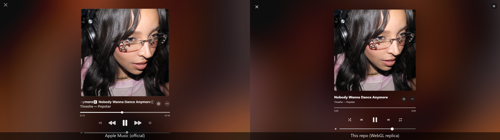
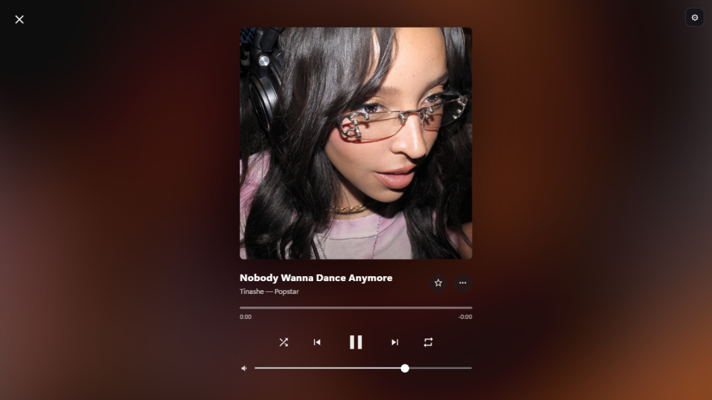

# Apple Music 网页版 · 全屏播放器流体背景复刻

对 Apple Music **网页版**（music.apple.com）全屏播放器的动态流体背景（社区俗称 Burst / 流体渐变背景）进行实现分析，并以**原生 WebGL 零依赖** 1:1 复刻。`demo/index.html` 双击即开，无需构建、无需任何依赖。

<p align="center">
  
</p>
<p align="center"><sub>左：Apple Music 网页版官方渲染；右：本仓库 demo 的实时渲染（同曲、同封面、同为 1280×720）。</sub></p>



---

## 快速开始

```bash
# 方式一：直接双击打开
demo/index.html

# 方式二：本地静态服务（file:// 下核心功能可用，http 下额外支持在线封面加载）
python -m http.server 8000
# 浏览器打开 http://localhost:8000/demo/
```

- 播放界面为仿官方布局的静态示意，播放/暂停键可控制背景动画
- 把**任意图片**拖进窗口 / `Ctrl+V` 粘贴，即可换成自己的封面
- 面板中所有参数均以 **Apple 线上原值**为默认，可实时调整对比
- 快捷键：`空格` 播放/暂停 · 数字键切曲目 · `H` 收起面板

## 实现了什么（渲染管线）

Apple 的实现：一个 PixiJS 场景（4 层旋转的封面精灵）挂一整条滤镜链，上面再罩一层黑/白遮罩。
本仓库按同样结构用原生 WebGL 复刻，共 4 个 pass：

```
四层封面精灵（宽 × 1.25 / 0.8 / 0.5 / 0.25，转速 +.003 / −.008 / −.006 / +.004 / 33.33ms）
  → pass1 合成（白色底 + 预乘 over，换曲时新精灵从白底上淡入 ≈1.65s）
  → pass2 扭曲（pixi-filters TwistFilter 公式，angle −3.25 / radius 900）
  → pass3 模糊（Apple 自带滤镜链 (5,1)(10,1)(20,2)(40,2)(80,2) 展开为 7 道递减 box 模糊）
  → pass4 调色（saturation 2.75 / contrast 1.9 / brightness 0.7，clamp 后叠 黑50% + 白5% 罩层）
```

**为什么 Apple 的漩涡"看不太出来"、像水墨晕染？** 本项目对照 Apple 线上渲染脚本逐行核对，
确认了 7 处公开资料未覆盖的关键实现细节（完整推导见 [docs/实现解析.md](docs/实现解析.md)）：

| # | 实现细节 | 一句话解释 |
|---|------|-----------|
| 1 | 模糊真身是 5 个内嵌 v4 系 BlurFilter，**递减 box 核**（每 pass 采 4 个对角角点） | 递减 box 扩散保留中间频，才是「水墨」质感；等效高斯出不来这个手感 |
| 2 | AdjustmentFilter 不止饱和度，还有 **brightness 0.7 + contrast 1.9** | 此前公开资料只提到 saturation 2.75 |
| 3 | 换曲 = 旧精灵瞬间移除，新精灵 **从舞台白色底上淡入**（±0.02/帧 ≈1.65s） | 不是流体间交叉淡化；且适配 `prefers-reduced-motion` |
| 4 | 流体之上叠 **黑 50% + 白 5% 全屏罩层** | 动态范围被压掉一半，这是「看不出漩涡」的关键 |
| 5 | 公转的小精灵**显示自转取负号**（自转与公转逆行）；`ticker.maxFPS=15` | texture 相对轨道「翻滚」+ 15fps 步进感，都是水流感来源 |
| 6 | 滤镜链 frame **出屏扩展 ≈229px** | 画面边缘的模糊采的是屏外真实内容，不是黑边 |
| 7 | ★ 传给场景的封面是 **40×40 webp 缩略图**，不是原图 | 40×40 色板放大 40 倍 = 天然无细节的纯色晕染，「水墨感」的最终来源 |

> 其中 **#7 最重要**：喂 600×600 原图，细节会穿透模糊层，观感立刻「不对劲」；
> 喂 40×40 缩略图则一步到位。本项目初次对比时色调/结构都对不上，就是栽在这一条上。

## 目录结构

```
├── demo/
│   └── index.html          # 全部内容：原生 WebGL 实现 + 仿官方播放界面 + 参数面板（单文件，零依赖）
├── docs/
│   ├── 实现解析.md          # 实现分析方法、渲染管线、7 处关键细节与参数推导
│   └── comparisons/
│       ├── side-by-side-tinashe.png     # 官方帧 vs 复刻帧（同曲同封面）
│       ├── compare-demo-tinashe.webm    # 复刻版动态效果录制（Tinashe）
│       └── compare-demo-adela.webm      # 复刻版动态效果录制（ADÉLA）
└── assets/
    └── demo-screenshot.png
```

## 验证方法

1. 获取 Apple 线上页面交付的全屏播放器渲染脚本（scene 模块），与公开分析资料逐值核对；
2. 官方页面录屏逐帧抽帧（ffmpeg），与复刻输出同曲、同封面、同分辨率对比；
3. 对比图见 [docs/comparisons/](docs/comparisons/)，动态录制为同名 `.webm`。

## 致谢

- [aadishv 对 Apple Music 背景渐变的效果分析](https://www.aadishv.dev/music)
  及其开源还原仓库 [aadishv/html-music](https://github.com/aadishv/html-music)（Pixi.js 版 bundle.ts，本项目复刻起点）
- [pixi.js](https://github.com/pixijs/pixijs) / [pixi-filters](https://github.com/pixijs/filters)（TwistFilter、AdjustmentFilter 公式来源，MIT）
- [Material Symbols](https://fonts.google.com/icons)（播放界面图标参考，Apache-2.0）

## 免责声明

本项目仅供学习与技术研究，与 Apple Inc. 无任何关联。Apple Music 及相关商标归 Apple Inc. 所有；
demo 中引用的专辑封面链接指向 Apple CDN，版权归原作者所有。请勿将本项目用于任何商业用途。
